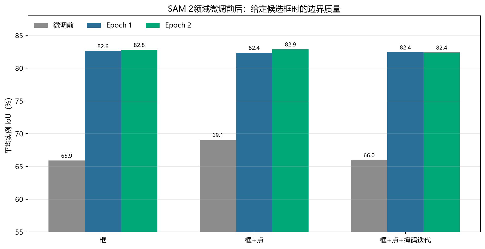
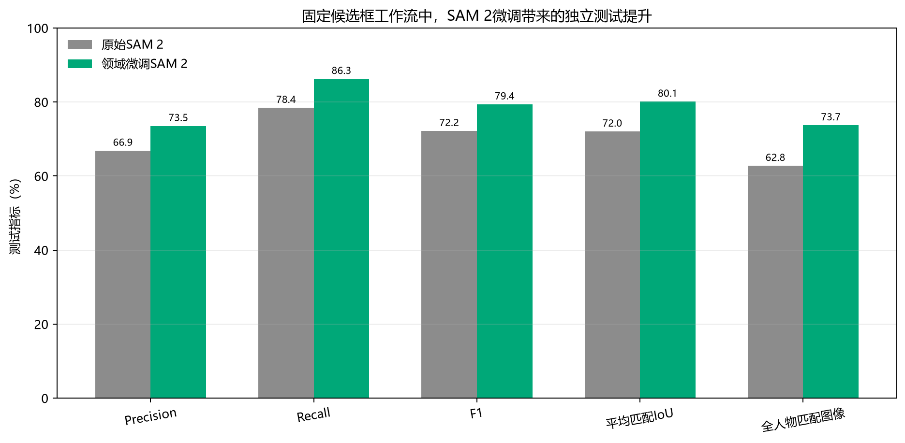
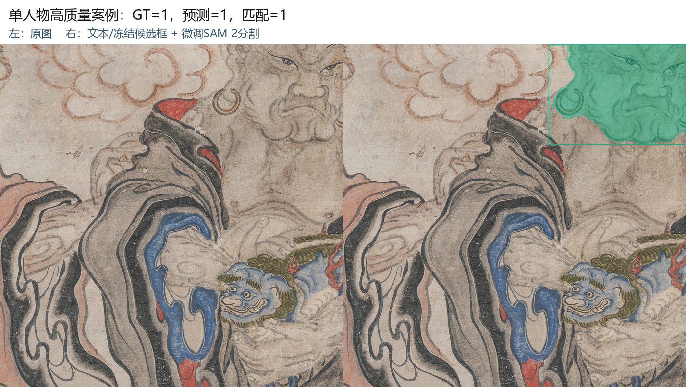
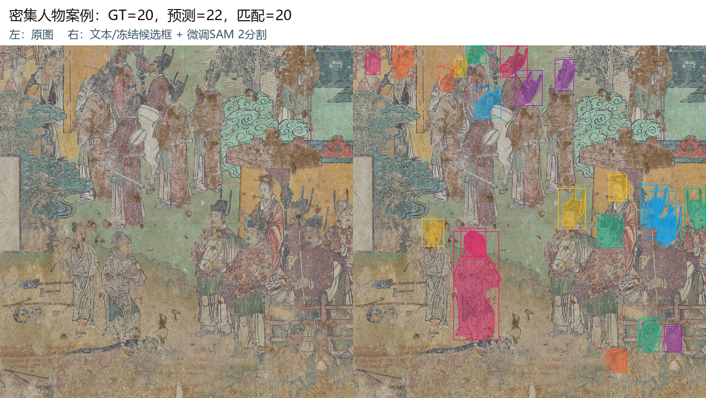
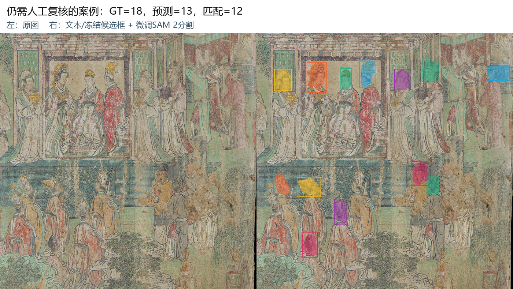

# 15-Temple Text-Prompt Candidate and SAM 2 Domain-Tuning Report

## 1. Objective

This work does not compare Mask R-CNN masks against SAM 2 masks as competing outputs. It optimizes the complete
workflow below:

```text
text prompt: person.
    ↓
Grounding DINO generates text-relevant candidate boxes
    ↓
the frozen project RCNN model supplements mural-person candidates
    ↓
NMS merges duplicate candidates
    ↓
candidate boxes + foreground points are passed to domain-tuned SAM 2
    ↓
person-instance masks, overlays, and structured results are produced
```

The RCNN component uses the existing delivered weight:

`outputs/deliverables/15temple_person_segmentation_training_package/model/maskrcnn_person_latest.pth`

RCNN was not updated, overwritten, or included in backpropagation. Its SHA-256 is:

`813131D3EA54835E3A13FBE5A7DD9EB457EE54587823057178CF1711D428BEF2`

## 2. Data split

| Purpose | Images | Description |
|---|---:|---|
| SAM 2 weight fine-tuning | 1,080 | From the original 1,200-image training split |
| SAM 2 calibration | 120 | Fixed internal split from training data, seed=42 |
| Independent quantitative test | 137 | 422 human-annotated person instances; never used for tuning |
| Inference-only display | 1 | No ground-truth mask; excluded from accuracy calculations |

The test set was not used to choose learning rates, prompt modes, thresholds, or checkpoints.

## 3. How SAM 2 was tuned

### 3.1 Trainable and frozen components

- The SAM 2 image encoder, memory modules, and other backbone parameters were frozen.
- The prompt encoder and mask decoder were trained, totaling `4,221,329` trainable parameters.
- The original SAM 2.1 Base+ checkpoint was preserved; domain weights were saved separately.
- RCNN and Grounding DINO weights remained frozen.

### 3.2 Prompt simulation during training

Three prompt types were sampled so SAM 2 could adapt to realistic candidate-box errors:

1. Box only, used for about 25% of training images.
2. Box plus an internal foreground point, used for about 50%.
3. Box, foreground point, and coarse-mask prompt, used for about 25%.

Candidate coordinates received up to 5% random jitter. The foreground point was chosen at the location inside the
person mask farthest from its boundary. Coarse masks were generated by random erosion or dilation of manual masks to
simulate an imprecise first-pass segmentation.

### 3.3 Optimization settings

| Item | Setting |
|---|---|
| Optimizer | AdamW |
| Epoch 1 learning rate | `1×10⁻⁵` |
| Epoch 2 learning rate | `5×10⁻⁶` |
| Weight decay | `1×10⁻⁴` |
| Maximum person instances per step | 4 |
| Mixed precision | CUDA bfloat16 |
| Gradient clipping | maximum norm 1.0 |
| Loss | BCE + Dice + 0.2×IoU quality regression |

### 3.4 Changes over two epochs

| Stage | Training loss | Best mean IoU on calibration set | Fraction with IoU≥0.75 |
|---|---:|---:|---:|
| Before tuning | - | 69.08% | 37.22% |
| Epoch 1 | 0.12439 | 82.61% | 88.61% |
| Epoch 2 | 0.10681 | 82.90% | 88.61% |



Given person candidate boxes, the best mean IoU increased from 69.08% to 82.90%, an improvement of 13.82 percentage
points.

## 4. Selecting full-workflow parameters

A broad search of 108 combinations was first performed on 40 calibration images, followed by a focused search on all
120 calibration images. The final parameters were:

| Parameter | Final value |
|---|---:|
| Text prompt | `person.` |
| Grounding DINO candidate threshold | 0.5 |
| Frozen RCNN candidate threshold | 0.5 |
| Candidate-box NMS threshold | 0.5 |
| SAM 2 prompt mode | box + foreground point |
| Candidate-box expansion | 2% |
| SAM 2 mask threshold | 0.0 |

End-to-end F1 was the primary calibration criterion; mean matched IoU and recall were secondary criteria. Parameters
were locked before final testing.

## 5. Independent test results

The “before/after tuning” results below use exactly the same text prompt, candidate boxes, candidate count, and
thresholds. Only the SAM 2 weights changed.

| Metric | Original SAM 2 | Domain-tuned SAM 2 | Change |
|---|---:|---:|---:|
| Ground-truth person instances | 422 | 422 | unchanged |
| Output candidates/masks | 495 | 495 | unchanged |
| Correctly matched persons | 331 | 364 | +33 |
| Precision | 66.87% | 73.54% | +6.67 pp |
| Recall | 78.44% | 86.26% | +7.82 pp |
| F1 | 72.19% | **79.39%** | **+7.20 pp** |
| Mean matched IoU | 72.04% | **80.11%** | **+8.07 pp** |
| Median matched IoU | 73.37% | 81.49% | +8.11 pp |
| Images with at least one matched person | 87.59% | 91.97% | +4.38 pp |
| Images with all GT persons matched | 62.77% | 73.72% | +10.95 pp |



With the candidate count held constant, the tuned SAM 2 correctly matched 33 additional persons. This indicates that
the gain came from SAM 2 adapting to mural-person boundaries and prompt conditions, not from adding more candidates.

## 6. Test visualizations

- **High-quality single-person case**: `3c69384a-140525-0087-JZ01-BH01_ZDBQ419.jpg`; GT=1, prediction=1, match=1.
- **Dense-person case**: `85320cfd-140581-0290-JZ08-BH01073.jpg`; GT=20, predictions=22, matches=20.
- **Case still requiring manual review**: `c0f493c7-140581-0290-JZ08-BH01040.jpg`; GT=18, predictions=13, matches=12.







The complete output contains 138 overlays and 496 person-mask files in the original experiment directory:

`runs/15temple_sam2_tuned/final_test_outputs`

Of these, 137 images have ground truth and participate in quantitative testing; one image contains inference output
only.

## 7. Interpreting the workflow

### Text-prompt stage

Grounding DINO receives the `person.` prompt and searches for regions semantically related to people. The prompt can
be changed, but other target types require recalibration of the text threshold and confirmation that corresponding
SAM 2 training data exist.

### Candidate-supplement stage

The existing RCNN model supplements mural-person candidates that the text model may miss. It is only a frozen source
of candidate boxes in this work; it does not participate in SAM 2 training and was not re-optimized.

### Fine-segmentation stage

SAM 2 receives candidate boxes and foreground points and outputs a pixel-level mask for each person. Domain tuning
helps it adapt to line work, damage, low contrast, clothing patterns, and complex mural backgrounds.

## 8. Limitations

1. The current test is a fixed random image split, not a cross-temple test containing only unseen temples.
2. The text model may produce semantically related non-person boxes, so precision remains lower than recall.
3. If the candidate stage completely misses a person, SAM 2 cannot recover that person from no prompt.
4. Fine-tuning covers only the person class and does not establish equal performance for clothing, objects,
   architecture, or other heritage semantics.
5. Results are suitable for review-assisted batch pre-annotation and should not replace expert judgment without review.

## 9. Further improvement

1. Use validation splits grouped by temple to assess cross-temple generalization.
2. Return missed persons to the text-detection and candidate-supplement training process.
3. Add targeted samples for small, damaged, overlapping, and low-contrast figures.
4. Build Chinese and English prompt vocabularies such as `person`, `human figure`, and `deity figure`, and calibrate
   thresholds separately.
5. Record accepted, edited, and rejected masks and feed those reviewed outcomes back into SAM 2 training.

## 10. Main deliverables

- `model/sam2_mural_best.pt`: final domain-tuned SAM 2 weight.
- `config/selected_workflow.json`: final workflow parameters and test summary.
- `metrics/training_history.json`: two-epoch training and calibration history.
- `metrics/test_metrics_base_sam2.json`: original SAM 2 baseline under the same workflow.
- `metrics/test_metrics_tuned_sam2.json`: final domain-tuned SAM 2 test results.
- `metrics/person_predictions.json`: candidate boxes, scores, SAM quality scores, and mask paths for 138 images.
- `report/SAM2领域微调与文本提示工作流报告.md`: this report.

---

# 15temple 文本提示候选框与 SAM 2 领域微调报告

## 1. 本次工作的目标

本次任务不是比较 Mask R-CNN 掩码与 SAM 2 掩码谁更好，而是优化以下完整链路：

```text
文本提示 person.
    ↓
Grounding DINO 生成文本相关候选框
    ↓
冻结的项目 RCNN 模型补充壁画人物候选框
    ↓
NMS 合并重复候选框
    ↓
候选框 + 前景点输入领域微调后的 SAM 2
    ↓
输出人物实例掩码、可视化叠加图和结构化结果
```

RCNN使用的是既有交付权重，文件为：

`outputs/deliverables/15temple_person_segmentation_training_package/model/maskrcnn_person_latest.pth`

本次没有更新、覆盖或反向传播到RCNN。其SHA256为：

`813131D3EA54835E3A13FBE5A7DD9EB457EE54587823057178CF1711D428BEF2`

## 2. 数据划分

| 用途 | 图片数 | 说明 |
|---|---:|---|
| SAM 2权重微调 | 1080 | 来自原1200张训练集 |
| SAM 2参数校准 | 120 | 从训练集内部固定划出，seed=42 |
| 独立量化测试 | 137 | 422个人工人物实例，未参与调参 |
| 仅推理展示 | 1 | 没有人工标准掩码，不计入准确率 |

测试集没有参与学习率、提示方式、阈值或checkpoint选择。

## 3. SAM 2如何调整

### 3.1 修改与冻结范围

- 冻结SAM 2图像编码器、记忆模块和其他主干参数。
- 训练SAM 2提示编码器和掩码解码器，共`4,221,329`个可训练参数。
- 保持原始SAM 2.1 Base+ checkpoint不变，另存领域权重。
- RCNN和Grounding DINO权重全部冻结。

### 3.2 训练提示模拟

训练时随机使用三类提示，使SAM 2适应实际候选框误差：

1. 仅候选框，约25%的训练图片。
2. 候选框加人物内部前景点，约50%。
3. 候选框、前景点加粗糙掩码提示，约25%。

候选框坐标加入最多5%的随机扰动。前景点选择人物掩码内部距离边界最远的位置；粗糙掩码通过随机腐蚀或膨胀人工掩码生成，模拟第一轮不精确分割。

### 3.3 优化设置

| 项目 | 设置 |
|---|---|
| 优化器 | AdamW |
| Epoch 1学习率 | `1×10⁻⁵` |
| Epoch 2学习率 | `5×10⁻⁶` |
| 权重衰减 | `1×10⁻⁴` |
| 每步最大人物实例 | 4 |
| 混合精度 | CUDA bfloat16 |
| 梯度裁剪 | 最大范数1.0 |
| 损失 | BCE + Dice + 0.2×IoU质量回归 |

### 3.4 两轮训练变化

| 阶段 | 训练损失 | 校准集最佳平均IoU | IoU≥0.75比例 |
|---|---:|---:|---:|
| 微调前 | - | 69.08% | 37.22% |
| Epoch 1 | 0.12439 | 82.61% | 88.61% |
| Epoch 2 | 0.10681 | 82.90% | 88.61% |


在给定人物候选框的条件下，最佳平均IoU从69.08%提高到82.90%，提高13.82个百分点。

## 4. 完整工作流参数如何确定

先在40张校准图片上执行108组宽网格搜索，再在全部120张校准图片上搜索最优区域。最终参数如下：

| 参数 | 最终值 |
|---|---:|
| 文本提示 | `person.` |
| Grounding DINO候选阈值 | 0.5 |
| 冻结RCNN候选阈值 | 0.5 |
| 候选框NMS阈值 | 0.5 |
| SAM 2提示方式 | 框 + 前景点 |
| 候选框外扩 | 2% |
| SAM 2掩码阈值 | 0.0 |

校准阶段以端到端F1为第一选择条件，以平均匹配IoU和召回率作为次级条件。最终测试开始后不再修改参数。

## 5. 独立测试结果

下面的“微调前/后”使用完全相同的文本提示、候选框、候选数量和阈值，唯一变化是SAM 2权重。

| 指标 | 原始SAM 2 | 领域微调SAM 2 | 变化 |
|---|---:|---:|---:|
| GT人物实例 | 422 | 422 | 不变 |
| 输出候选/掩码 | 495 | 495 | 不变 |
| 成功匹配人物 | 331 | 364 | +33 |
| Precision | 66.87% | 73.54% | +6.67个百分点 |
| Recall | 78.44% | 86.26% | +7.82个百分点 |
| F1 | 72.19% | **79.39%** | **+7.20个百分点** |
| 平均匹配IoU | 72.04% | **80.11%** | **+8.07个百分点** |
| 中位匹配IoU | 73.37% | 81.49% | +8.11个百分点 |
| 至少匹配一人的图片 | 87.59% | 91.97% | +4.38个百分点 |
| 全部GT人物均匹配的图片 | 62.77% | 73.72% | +10.95个百分点 |


结论：在候选框数量完全不变的情况下，微调后的SAM 2多正确匹配33个人物，说明提升来自SAM 2对壁画人物边界和提示方式的适应，而不是增加候选框数量。

## 6. 测试图片可视化

- **单人物高质量案例**：`3c69384a-140525-0087-JZ01-BH01_ZDBQ419.jpg`，GT=1，预测=1，匹配=1。
- **密集人物案例**：`85320cfd-140581-0290-JZ08-BH01073.jpg`，GT=20，预测=22，匹配=20。
- **仍需人工复核的案例**：`c0f493c7-140581-0290-JZ08-BH01040.jpg`，GT=18，预测=13，匹配=12。


完整输出包括138张叠加图和496张人物掩码文件，位于：

`runs/15temple_sam2_tuned/final_test_outputs`

其中137张有标准答案并参与量化测试，另1张只输出推理结果。

## 7. 如何理解这套工作流

### 文本提示阶段

Grounding DINO接收`person.`文本提示，寻找与“人物”语义相关的候选区域。当前输入文本可以替换，但更换为其他目标类型后，需要重新校准文本阈值并确认SAM 2是否有对应训练数据。

### 候选补充阶段

已有RCNN模型用于补充文本模型可能漏掉的壁画人物候选。它在本次任务中只是冻结的候选框来源，不参与SAM 2训练，也没有被重新优化。

### 精细分割阶段

SAM 2接收候选框和前景点，输出每个人物的像素级掩码。领域微调使它更适应壁画中的线描、残损、低对比、服饰纹样和复杂背景。

## 8. 仍然存在的限制

1. 当前测试是固定随机图片划分，不等同于“完全未见寺庙”的跨寺庙测试。
2. 文本模型可能产生语义相关但并非人物的框，因此Precision仍低于Recall。
3. 如果候选阶段完全漏掉人物，SAM 2无法凭空恢复该人物。
4. 微调只覆盖人物类别，不能直接声称对服饰、器物、建筑或其他文物语义同样有效。
5. 结果适合作为人工复核和批量预标注，不应未经审核直接替代文物专家判断。

## 9. 后续提高方向

1. 使用按寺庙分组的验证集，检查跨寺庙泛化。
2. 将漏检人物重新加入文本检测和候选补充训练集。
3. 为小人物、残损人物、多人重叠和低对比人物增加专项样本。
4. 对文本提示建立中英文词表，例如`person`、`human figure`、`deity figure`，分别校准阈值。
5. 保存人工接受、修改和驳回记录，持续回流训练SAM 2。

## 10. 主要交付物

- `model/sam2_mural_best.pt`：最终领域微调SAM 2权重。
- `config/selected_workflow.json`：最终工作流参数与测试摘要。
- `metrics/training_history.json`：两轮训练和校准变化。
- `metrics/test_metrics_base_sam2.json`：相同工作流下的原始SAM 2基线。
- `metrics/test_metrics_tuned_sam2.json`：最终领域SAM 2测试结果。
- `metrics/person_predictions.json`：138张图片的候选框、分数、SAM质量分数和掩码路径。
- `report/SAM2领域微调与文本提示工作流报告.md`：本报告。
